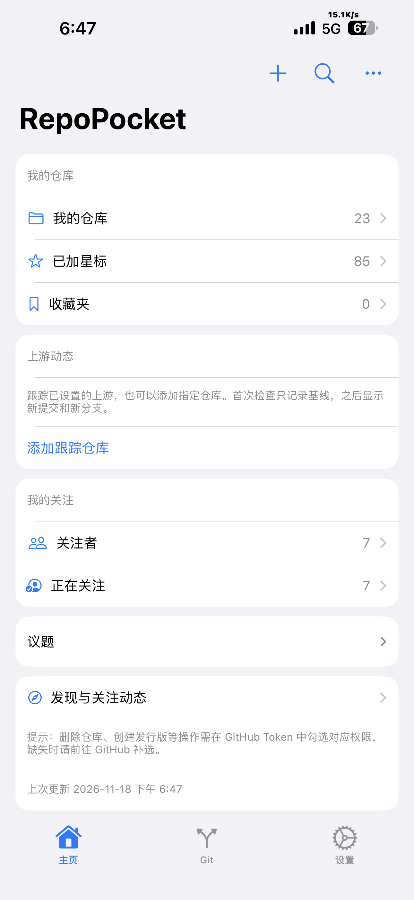
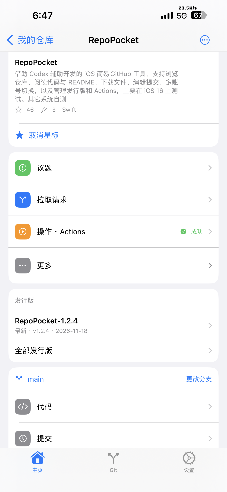
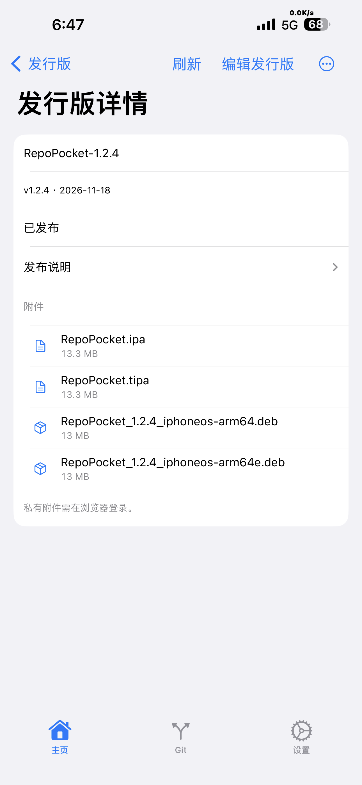
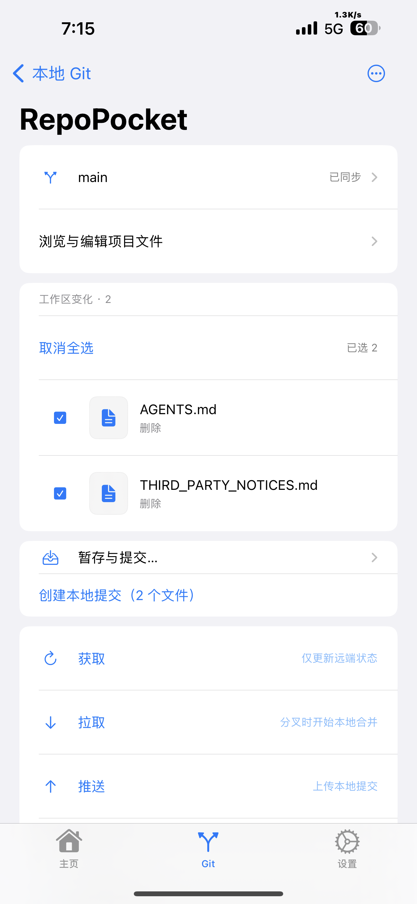
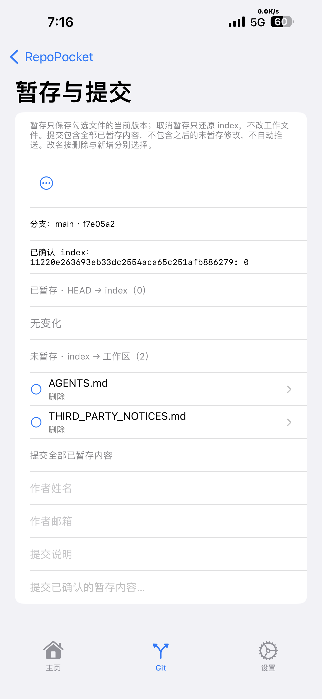
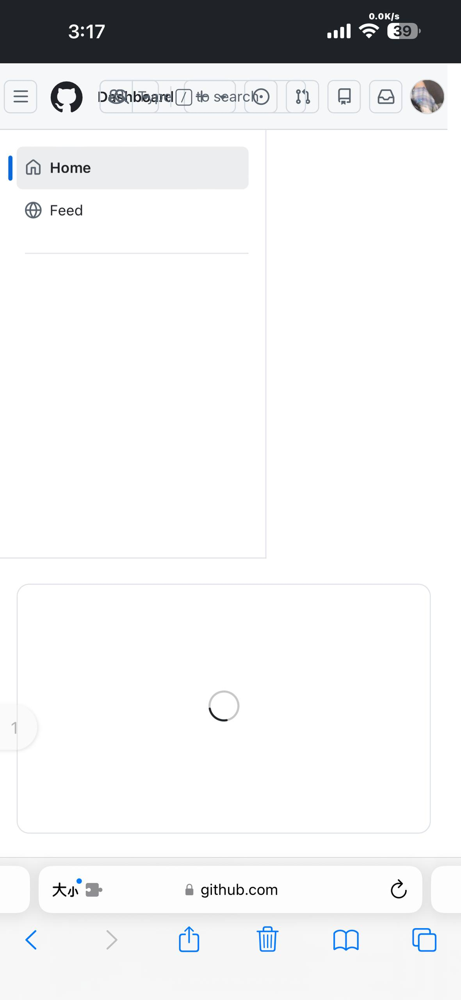
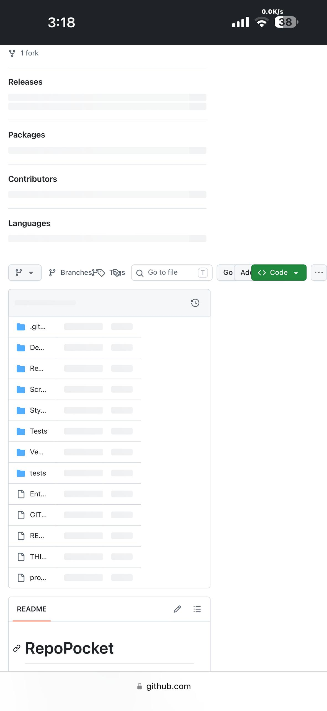
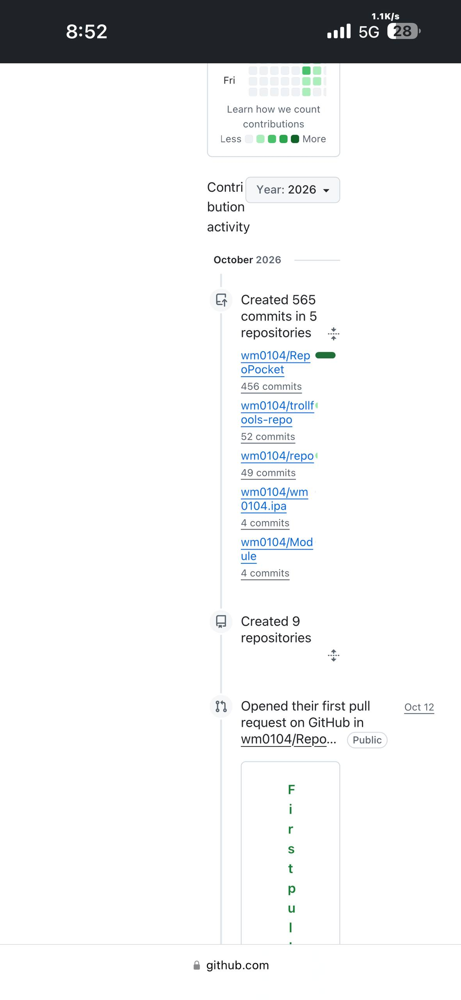

# RepoPocket

**在 iPhone、iPad 上浏览 GitHub、编辑代码和管理 Git 项目。**

## 下载与安装

### [下载最新版本](https://github.com/wm0104/RepoPocket/releases/latest)

**兼容目标：iOS 15～17。仅在 iOS 16.3 真机测试，其他系统版本请自行测试。**

## 说明

RepoPocket 借助 **Codex 辅助开发**，功能仍在完善，欢迎通过 [Issues](https://github.com/wm0104/RepoPocket/issues) 反馈问题。

## 界面预览

<table>
<tr><th>首页</th><th>仓库主页</th><th>发行版详情</th></tr>
<tr><td></td><td></td><td></td></tr>
</table>

展开查看本地 Git 功能

<table>
<tr><th>Git 工作区</th><th>暂存与提交</th></tr>
<tr><td></td><td></td></tr>
</table>

为什么开发 RepoPocket？查看 iOS 16.3 真机情况

在 iOS 16.3 真机上，使用 Safari 浏览 GitHub 时，曾遇到页面布局错乱、按钮挤在一起、代码和文件难以打开等情况。

**RepoPocket 就是为改善这些日常使用中的不便而开发的。**

下面是当时实际遇到的 Safari 网页显示情况：

<table>
<tr><th>GitHub 首页</th><th>仓库与代码</th><th>个人主页</th></tr>
<tr><td></td><td></td><td></td></tr>
</table>

## 能做什么

- **浏览与阅读**：查看仓库、代码、README、分支和提交历史，支持搜索与代码预览。
- **编辑与上传**：编辑文本、上传和删除文件，提交到有权限的仓库分支。
- **本地 Git**：克隆或关联项目，查看差异、暂存、提交、拉取、推送及处理合并冲突。
- **协作管理**：查看和参与 Issue、PR、讨论与代码审查，收藏、复刻仓库并同步上游更新。
- **发行版与下载**：创建和管理发行版，下载文件、仓库 ZIP、附件和构建产物，自选保存目录。
- **GitHub Actions**：筛选工作流、查看运行状态和日志、填写参数启动运行，以及重跑失败任务。
